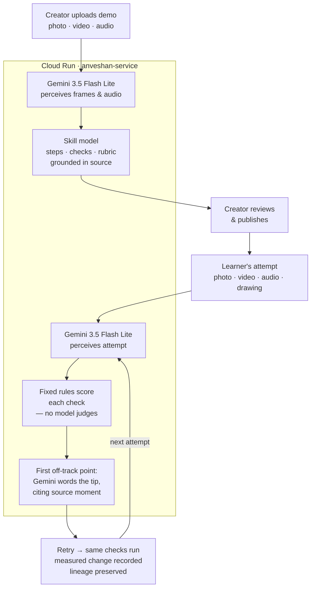

# Anveshan

Anveshan passes on skills of the physical world from one person to another: learned from a real demonstration, practised with real hands, and checked against a photo, video or recording of the learner's real attempt.

[Live demo](https://anveshan-VERIFY.run.app) <!-- [VERIFY: Cloud Run URL] -->

<!-- [VERIFY: add hero screenshot at docs/hackathon/img/hero.png] -->
<!--  -->

**Hackathon:** Google Cloud AI Builder Cup 2026

---

## How it works

A creator uploads a real demonstration. Gemini structures the skill into steps, checks and source-grounded evidence. A learner submits their attempt; **deterministic rules score each check — no model decides pass or fail**. The first place the attempt diverges triggers a Gemini-worded tip pointing back to the exact source moment. On the retry, the same checks run and the measured change is recorded.



**Built with Gemini on Google Cloud.** Perception (frames & audio): Gemini 3.5 Flash Lite [VERIFY: confirm model in production config]. Source alignment embeddings: Gemini Embedding 2. Coaching tip wording: Gemini 3.5 Flash Lite. Pass/fail scoring: fixed deterministic rules, no model. Hosted on Cloud Run.

Scores come from a fixed rubric, not from a model judgment. See [where Gen AI is used](#where-gen-ai-is-used-and-where-it-is-not).

**Quick start**

```powershell
git clone https://github.com/learnermaker/anveshan
cd anveshan
.\start.ps1 mock   # UI only, no API key needed → http://localhost:5174
```

---

## Try it

Live URL: `https://<cloud-run-url>` (added at deployment)

**First-time visitor path:**

1. Open the **Kolam drawing** — a traditional Indian floor art skill, sourced from a real Wikimedia photo.
2. Press **Start practising** and use **Try a sample attempt**, or draw it yourself on the canvas.
3. Read the feedback and "Why this feedback?" for each criterion.
4. Do your second try and see what changed.

**Other paths:**
- **Share a skill you know** — upload a photo, short video, or audio clip; the system proposes a skill model; confirm the steps and publish.
- **My skills** — review and manage skills you have shared.
- **Steward console** — footer "Steward sign-in"; access code required.

---

## Three ways to use Anveshan

**Learner.** Anyone who wants to acquire a skill. Practise a bounded task, get feedback grounded in the source evidence, and see exactly what changed on your retry. Every feedback item links back to a specific step or claim in the original demonstration.

**Creator.** The expert, artisan or practitioner who shares a skill — or anyone sharing a source they hold the rights to. Upload a demonstration, confirm what the AI understood, and publish with clear credit and consent. See aggregated learner outcomes for each skill you share.

**Steward.** The body accountable for a collection of knowledge: a school, guild, heritage organisation, or company. Run the review queue, manage consent and licence records, and see usage and continuity insights. All insights are aggregate; no names or raw media are ever shown.

---

## The lifecycle and the evaluation core

Every skill flows through one lifecycle:

**CAPTURE → UNDERSTAND → GROUND → TRANSMIT → PRACTICE → VERIFY → EVOLVE**

**Evaluation core.** The system builds a goal model from the source: key steps, a rubric, and claims grounded in source evidence. When a learner submits an attempt, deterministic checks compare it to the goal model — no model decides whether a criterion passes or fails. The first place the attempt diverged from the model is identified, and targeted feedback is generated. On the retry, the same checks run and the change is measured.

See [`docs/plans/evaluation-core.md`](docs/plans/evaluation-core.md) and [`docs/plans/universal-pipeline.md`](docs/plans/universal-pipeline.md).

---

## Where Gen AI is used (and where it is not)

| Job | Model | Guard |
|---|---|---|
| Perceiving uploads | gemini-3.5-flash-lite; audio model configured separately (disabled by default; set `ANVESHAN_AUDIO_MODEL` to enable) | Recorded runs, explicit failures |
| Embeddings for alignment | gemini-embedding-2 | — |
| Answering questions about a skill | gemini-3.5-flash-lite, from cited claims only | Insufficient-evidence refusal |
| Wording coaching advice | gemini-3.5-flash-lite | Guard rejects new numbers or verdict words; template fallback |
| Scoring, pass/fail, permissions, insights | **no model** | Deterministic bands and rules |

**Cost control.** Identical calls are answered from stored runs, the shared key has a daily call budget, Kolam and Tabla scoring use no model, images are downsized and sent to Gemini 3 at a matching media resolution, and output is capped. Token use is recorded per run (`tools/token_report.py`). Details: [`docs/architecture/token-economy.md`](docs/architecture/token-economy.md).

**Your own key.** Visitors can add their own Gemini API key in the app (key button in the header, or the prompt next to any upload that needs AI). It stays in their browser, is sent only to this service in a request header, and their calls skip the shared budget.

---

## Evidence (engineering, not user validation)

All evidence to date is engineering and capability evidence on internet-licensed and synthetic data.

- Experiment log (E1-E9): [`docs/validation/experiments.md`](docs/validation/experiments.md)
- Non-live test suite: **568 tests** as of 2026-10-08 (`pytest -m "not live"`)
- Stability: every sample attempt of Kolam, Tabla and the origami crane gives the same outcome across 3 runs (crane runs were live Gemini calls): [`app/public/evidence.json`](app/public/evidence.json)
- Judges-panel review: [`docs/research/judges-panel-review-2026-10-07.md`](docs/research/judges-panel-review-2026-10-07.md)

**No study with real learners or experts has been run yet.**

---

## Limits

- **Recorded runs first, live for new uploads.** On Cloud Run the service runs in live mode: anything already recorded (all sample attempts) is replayed from committed golden runs, so it is free and gives the same result every time; new uploads call Gemini within a daily budget and may vary slightly between runs (see E6, E7). Locally the default is recorded mode, which needs no key.
- **Demo storage is temporary.** Uploaded media and composed skills are kept in memory; data is retained for about 6 hours; published skills persist until the service restarts.
- **No accounts.** Ownership is tracked per browser session.
- **Internet sources are not verified experts.** Hero case media comes from Wikimedia Commons under open licences. It is labelled INTERNET REFERENCE in the UI; the photographer or uploader is not an Anveshan expert.
- **Known weak spots (universal pipeline, from `docs/plans/universal-pipeline.md` §12.3):**
  - Global embeddings separate scenes, not fine-grained object states; step identity varies between live runs for low-resolution hand-held footage.
  - Composed steps are proposals until the creator confirms them.
  - An attempt that is visually similar to the source but unrelated can land in the ambiguous relevance band and FAIL instead of being REFUSED.
  - Crop to the work region is not yet implemented for real hand-held footage.

---

## Run locally

**Quickest start (Windows):**

```powershell
.\start.ps1 mock   # UI only, no API key needed  → http://localhost:5174
.\start.ps1 full   # UI + backend service         → http://localhost:5173
```

`start.ps1` checks prerequisites, starts each process in its own terminal window, and prints the URLs. Run without arguments for an interactive prompt.

**Manual setup:**

```bash
# Python environment (first time)
python -m venv .venv
pip install -r requirements-dev.txt
python tools/fetch_media.py       # downloads licensed media from Wikimedia Commons

# Service — recorded mode, no API key required (port 8080)
.venv/Scripts/python -m uvicorn anveshan_service.main:app --app-dir service --reload --port 8080

# UI dev server — separate terminal (port 5173, proxies /api → :8080)
cd app && npm run dev
```

**Mock mode (no service required):** `cd app && npm run dev:mock` → http://localhost:5174

**Live model calls:** copy `.env.example` to `.env`, set `GEMINI_API_KEY`, and set `ANVESHAN_MODE=live`. Never commit `.env`.

---

## Deploy

See [`docs/deploy/DEPLOY-CHECKLIST.md`](docs/deploy/DEPLOY-CHECKLIST.md).
Set `ANVESHAN_STEWARD_TOKEN` as a Cloud Run secret before deploying.

---

## Repository map

```
app/              React + Vite frontend (TypeScript, strict)
service/          FastAPI service (Python)
tracks/common/    Shared contracts, models, and evaluation schemas (8 frozen contracts)
tracks/track-a/   Case ingestion, universal pipeline, and the Gemini model gateway
tracks/track-b/   Evaluators, feedback engine, and AI coach
tracks/cases/     Case packs: kolam, origami, origami-crane, tabla, and four synthetic showcase cases
docs/             Product vision, architecture, validation log, and plans
tools/            CLI tools: fetch media, smoke test, stability runs, sample generation, token report, repeated-text report
```

**Contributing.** Read [`AGENTS.md`](AGENTS.md) first. Each file and each rule has one canonical home; link to it instead of copying (`.github/scripts/check_duplicates.py` runs in CI). Coding-agent token tools (Graphify, RTK, Ponytail): [docs/architecture/agent-tools.md](docs/architecture/agent-tools.md).

---

## Licence

Code: Apache-2.0 ([LICENSE](LICENSE)).
Case media keep their own licences; see each pack's `source/source.json`.

---

## Team and competition

Google Cloud AI Builder Cup 2026. Submission due 2026-10-18.
